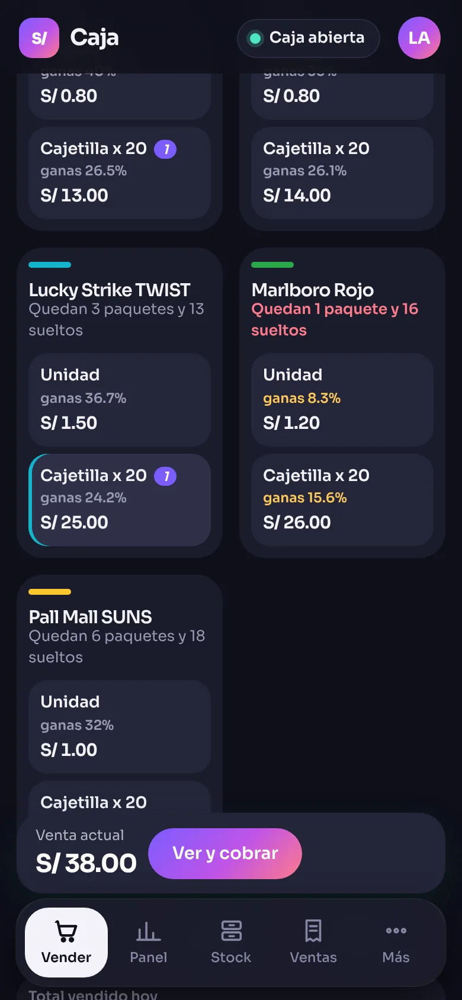
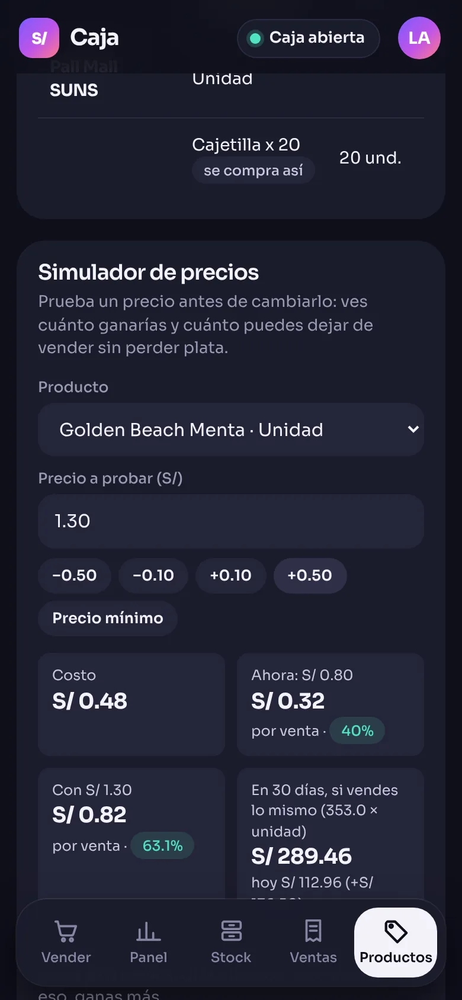

# Caja · Sistema de gestión comercial para un minorista

Aplicación web que uso a diario para administrar mi negocio de venta minorista en Pucallpa, Perú: ventas, compras, inventario, caja y resultados, desde el celular y la computadora.

**[Probar la demostración](https://sleepdong.github.io/caja/demo/)**: datos de ejemplo, sin registrarse y sin que se guarde nada.

<p>
  
  
  
</p>

---

## El problema

En un negocio pequeño el dinero entra todo el día, pero saber **cuánto se gana de verdad** es otra historia:

- Un cuaderno o un Excel registra cuánto se vendió, no cuánto quedó después del costo de la mercadería.
- Vender por **unidad suelta o por cajetilla** cambia el margen, y eso no se ve a simple vista.
- Los faltantes de inventario, los fiados olvidados y las subidas de precio de los proveedores se comen la ganancia en silencio.

## La solución

Una app instalable en el celular, pensada para usarse con una mano detrás del mostrador:

| Área | Qué resuelve |
|---|---|
| **Vender** | Ticket rápido por presentación (unidad o cajetilla), cobro con efectivo, Yape o Plin, vuelto y fiados. Funciona **sin internet** y sincroniza al reconectar sin duplicar ventas. |
| **Panel** | Ganancia del día, avance de la meta, margen explicado en soles ("de cada S/ 10 te quedan S/ 2.69") y ventas por hora. |
| **Inventario** | Costo promedio ponderado, alertas de reposición, pedido sugerido según la rotación y **conteo físico** que valoriza los faltantes. |
| **Compras** | Escaneo de facturas electrónicas (QR de SUNAT + OCR en el propio celular) e **historial de precios por proveedor** con alertas de subidas. |
| **Precios** | Alertas de margen bajo y **simulador**: cuánto se puede dejar de vender al subir un precio sin perder dinero. |
| **Fiados** | Quién debe y desde cuándo, con recordatorio por WhatsApp en un toque. |
| **Reportes** | Estado de resultados por periodo, ganancia por producto, análisis suelto vs. cajetilla, exportación a Excel y cierre de mes. |
| **Respaldo** | Copia de seguridad completa en Excel, una hoja por tabla. |

<p>
  
</p>

## Decisiones contables

Lo más interesante del proyecto fue traducir criterios contables en reglas que el sistema aplica solo:

- **Costo promedio ponderado:** cada compra recalcula el costo unitario. El flete y el IGV se suman al costo cuando no se usan como crédito fiscal.
- **Margen vs. markup:** el margen se calcula sobre la venta (lo que te queda de cada sol vendido) y el markup sobre el costo (lo que ganas por cada sol invertido). La app muestra los dos, explicados en soles.
- **Unidad base y presentaciones:** el stock se lleva en cigarros sueltos. La cajetilla es una presentación de 20, con su propio precio y su propio margen.
- **Mermas y ajustes:** los faltantes del conteo físico se registran como costo de ventas con motivo, no desaparecen.
- **Kardex y cierre de mes:** cada movimiento queda en un kardex valorizado. Un periodo cerrado ya no acepta registros con su fecha.
- **Caja con sesiones:** apertura, cierre con arqueo y diferencia, separando el efectivo de las billeteras digitales.

## Seguridad

- Base de datos **PostgreSQL** con *Row Level Security* en todas las tablas. Todas las operaciones pasan por funciones que validan el rol.
- **Verificación en dos pasos (TOTP)** exigida a nivel de base de datos, no solo en la pantalla.
- *Content Security Policy* estricta, librerías con *Subresource Integrity*, cierre de sesión por inactividad y registro de auditoría.

## Tecnología

| Capa | Herramienta |
|---|---|
| Interfaz | HTML, CSS y JavaScript sin framework, en un solo archivo; app instalable (PWA) con *service worker* |
| Datos | Supabase (PostgreSQL, Auth, RLS, `pg_cron`, `pg_net`) |
| Escaneo | jsQR y Tesseract.js, procesados en el dispositivo |
| Excel | SheetJS |
| Publicación | GitHub Pages |

## Cómo lo construí

Lo desarrollé **con ayuda de IA (Claude)**. Mi trabajo fue definir qué necesitaba el negocio, fijar las reglas contables, revisar cada cálculo contra casos reales y decidir el diseño. La IA escribió la mayor parte del código siguiendo esas decisiones.

Es un ejemplo de lo que busco aportar: **aplicar la IA a problemas reales de contabilidad y gestión en pequeños negocios**, sin perder el criterio profesional.

## Estructura

```
index.html          App completa (interfaz y lógica)
sw.js               Service worker: funcionamiento sin conexión
demo/demo.js        Base de datos de ejemplo en memoria para la demostración
demo/index.html     Demostración (se genera con tools/build_demo.py)
docs/               Capturas
```

---

**Luis Alvan Rojas** · Estudiante de Contabilidad (UTP) · Pucallpa, Perú
