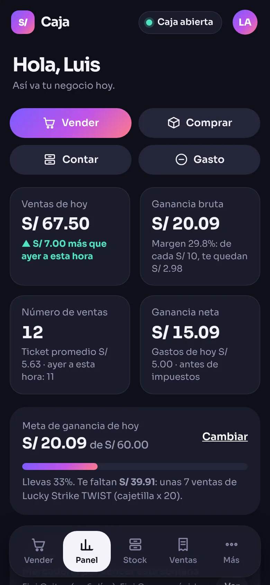
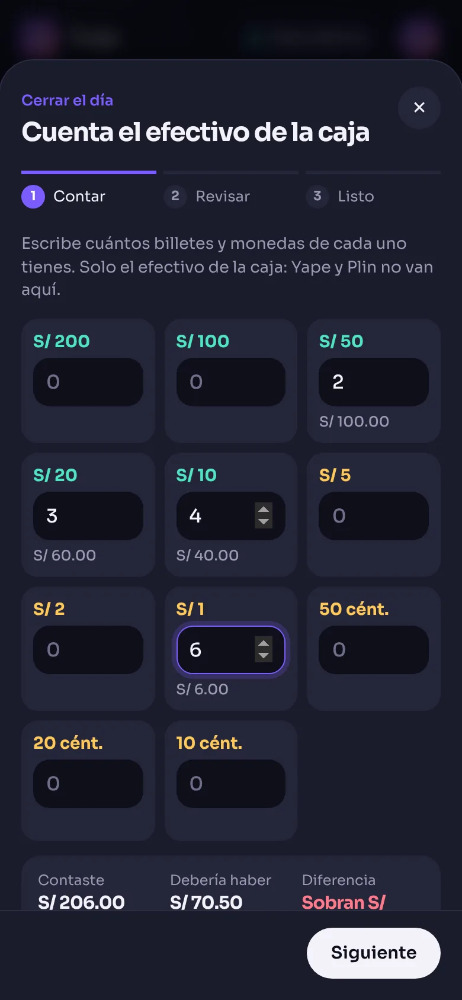
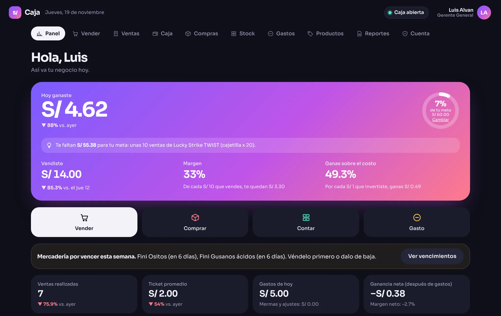
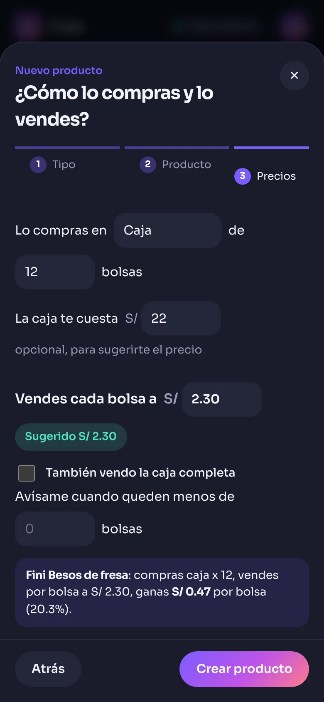
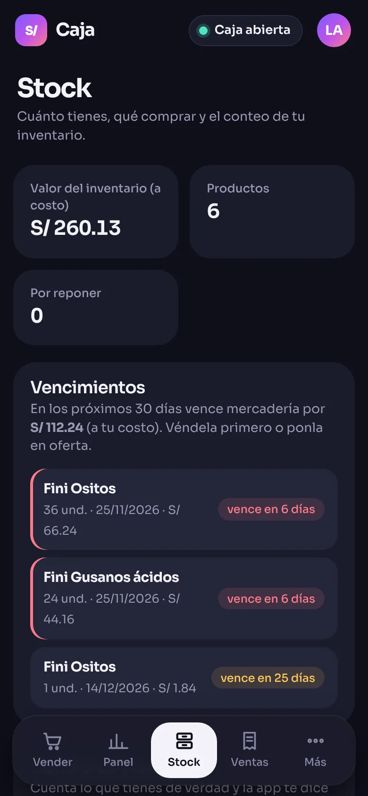
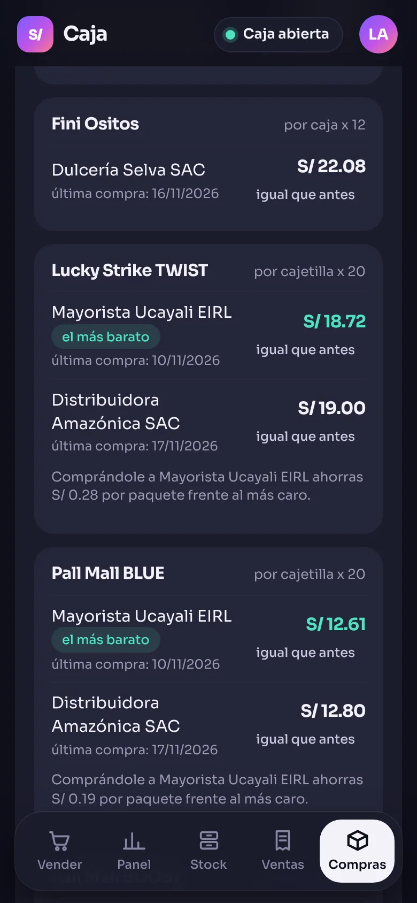

# Caja · Sistema de gestión comercial para un minorista

Aplicación web que uso a diario para administrar mi negocio de venta minorista en Pucallpa, Perú: ventas, compras, inventario, caja y resultados, desde el celular y la computadora.

**[Probar la demostración](https://sleepdong.github.io/caja/demo/)**: datos de ejemplo, sin registrarse y sin que se guarde nada.

<p>
  
  
  
</p>

---

## El problema

En un negocio pequeño el dinero entra todo el día, pero saber **cuánto se gana de verdad** es otra historia:

- Un cuaderno o un Excel registra cuánto se vendió, no cuánto quedó después del costo de la mercadería.
- Vender por **unidad suelta o por paquete** cambia el margen, y eso no se ve a simple vista.
- Los faltantes, los productos que vencen, los fiados olvidados y las subidas de precio de los proveedores se comen la ganancia en silencio.
- Registrar compras a mano, línea por línea, quita tiempo y produce errores.

## La solución

Una app instalable en el celular (PWA), pensada para usarse con una mano detrás del mostrador, y con atajos de teclado en la computadora.

| Área | Qué resuelve |
|---|---|
| **Vender** | Ticket rápido por presentación (unidad o paquete), filtros por categoría y lo más vendido primero. Cobro con efectivo, Yape o Plin, vuelto y fiados. Funciona **sin internet** y sincroniza sin duplicar ventas |
| **Panel** | Ganancia del día, anillo de avance de la meta, margen explicado en soles ("de cada S/ 10 te quedan S/ 2.69") y avisos de lo urgente |
| **Escáner de facturas** | Foto o **PDF**: lee el QR de SUNAT y el texto con OCR en el propio dispositivo. Reconoce productos **por código del proveedor**, tolera errores de lectura, registra **bonificaciones** a costo cero y crea productos nuevos con **precio sugerido**, avisando si ya existe uno igual |
| **Catálogo** | Categorías con su "receta" (cómo se compra y se vende), productos con **marca + variante** y nombre y código de factura. Asistente de 3 pasos para crear productos |
| **Inventario** | Costo promedio ponderado, **fechas de vencimiento** con alertas, pedido sugerido según la rotación y **conteo físico** que valoriza los faltantes |
| **Proveedores** | Historial de precios con alertas de subidas y **pedido por WhatsApp** con los códigos de cada proveedor |
| **Caja** | **Cerrar el día** en un recorrido: conteo por billetes y monedas, pendientes del día, cierre con arqueo y resumen por WhatsApp |
| **Fiados** | Quién debe y desde cuándo, con recordatorio por WhatsApp en un toque |
| **Reportes** | Estado de resultados por periodo, ganancia **por producto, marca y categoría**, análisis suelto vs. paquete, exportación a Excel y cierre de mes |
| **Respaldo** | Copia de seguridad completa en Excel, una hoja por tabla |

<p>
  
</p>

<p>
  
  
  
</p>

## Decisiones contables

Lo más interesante del proyecto fue traducir criterios contables en reglas que el sistema aplica solo:

- **Costo promedio ponderado:** cada compra recalcula el costo unitario. El flete y el IGV se suman al costo cuando no se usan como crédito fiscal, y las **bonificaciones** entran a costo cero y bajan el promedio.
- **Margen vs. markup:** el margen se calcula sobre la venta (lo que te queda de cada sol vendido) y el markup sobre el costo (lo que ganas por cada sol invertido). La app muestra los dos, explicados en soles.
- **Unidad base y presentaciones:** el stock se lleva en la unidad que se vende (cigarro, bolsa). La cajetilla o la caja es una presentación con su factor, su precio y su margen.
- **Primero en entrar, primero en salir para los vencimientos:** el stock restante se asigna a las compras más recientes, para saber qué lote vence y cuánto dinero está en riesgo.
- **Mermas y ajustes:** los faltantes del conteo y los productos vencidos se registran como costo de ventas con su motivo; no desaparecen.
- **Kardex y cierre de mes:** cada movimiento queda en un kardex valorizado. Un periodo cerrado ya no acepta registros con su fecha.
- **Caja con sesiones:** apertura y cierre con arqueo por denominación y diferencia anotada, separando el efectivo de las billeteras digitales.

## Seguridad

- Base de datos **PostgreSQL** con *Row Level Security* en las 36 tablas. Las operaciones contables pasan por funciones que validan el rol.
- **Verificación en dos pasos (TOTP)** exigida a nivel de base de datos, no solo en la pantalla.
- *Content Security Policy* estricta, librerías con *Subresource Integrity*, cierre de sesión por inactividad y registro de auditoría.
- Panel **"Tu seguridad"**: puntaje, dispositivos con la sesión abierta (con cierre remoto) y tiempo de cierre automático a elección. Al salir se borran del equipo las copias de datos del negocio.
- La demostración usa una base de ejemplo en memoria y un almacenamiento propio: no puede leer ni escribir datos reales.

## Pruebas automáticas


Cada cambio publicado pasa por **37 pruebas** en un navegador real (Playwright), en tamaño laptop y celular. Corren contra la demo, así que nunca tocan la base real.

| Grupo | Qué comprueba |
|---|---|
| Archivos | La CSP autoriza exactamente el código de la app, cada librería externa trae su huella (SRI), no hay `eval` ni claves secretas, la demo está al día |
| Flujos del negocio | Todas las pantallas abren sin errores; vender descuenta el stock y suma a la caja; conteo de inventario con "Lo vendí"; asistente de cierre del día |
| Teclado | Buscar, Enter agrega, Retroceso y Supr corrigen, F2 cobra |
| Seguridad | Cierre por inactividad, limpieza de datos al salir, aviso de ventas sin subir y un nombre de producto con código malicioso que se muestra como texto sin ejecutarse |

```
cd tests && npm install && npx playwright install chromium && npm test
```

## Tecnología

| Capa | Herramienta |
|---|---|
| Interfaz | HTML, CSS y JavaScript sin framework, en un solo archivo; PWA con *service worker* |
| Datos | Supabase (PostgreSQL, Auth, RLS, `pg_cron`, `pg_net`) |
| Escaneo | jsQR, Tesseract.js (con umbral adaptativo para tickets térmicos) y PDF.js, todo procesado en el dispositivo |
| Excel | SheetJS |
| Publicación | GitHub Pages |

## Cómo lo construí

Lo desarrollé **con ayuda de IA (Claude)**. Mi trabajo fue definir qué necesitaba el negocio, fijar las reglas contables, probar cada flujo con mis facturas reales y decidir el diseño. La IA escribió la mayor parte del código siguiendo esas decisiones.

Es un ejemplo de lo que busco aportar: **aplicar la IA a problemas reales de contabilidad y gestión en pequeños negocios**, sin perder el criterio profesional.

## Estructura

```
index.html          App completa (interfaz y lógica)
sw.js               Service worker: funcionamiento sin conexión
demo/demo.js        Base de datos de ejemplo en memoria para la demostración
demo/index.html     Demostración (se genera con tools/build_demo.py)
recordatorio/       Recordatorios de cierre para el calendario (.ics)
tests/              Pruebas automáticas (Playwright)
tools/              build_demo.py (genera la demo) y csp.py (recalcula la huella de la CSP)
docs/               Capturas
```

---

**Luis Alvan Rojas** · Estudiante de Contabilidad (UTP) · Pucallpa, Perú
